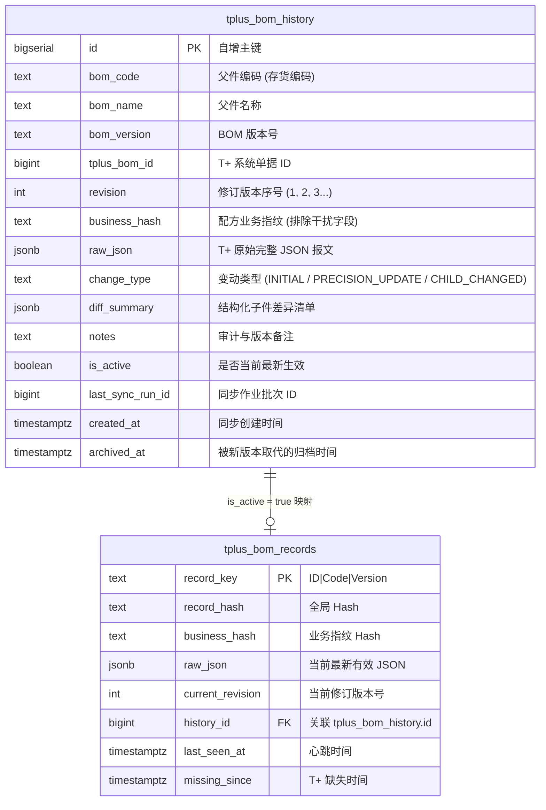
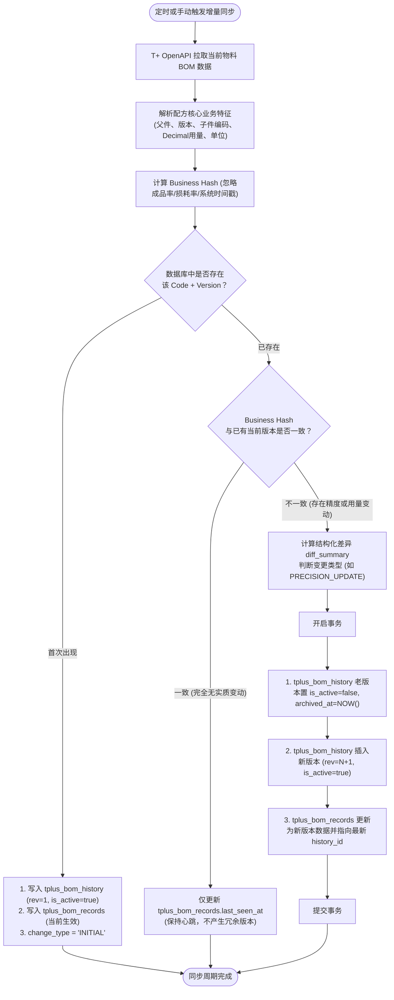
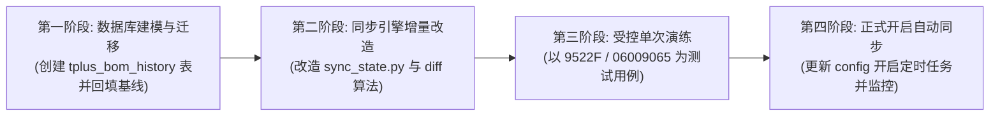

# 畅捷通 T+ 物料清单 (BOM) 增量同步与多版本历史归档体系方案设计

## 一、 系统定位与设计哲学

在制造业与材料研发企业的数字化体系中，物料清单（BOM / 配方）是企业最核心的技术资产与生产依据。
针对历史出现的“T+ 精度截断导致数据失真被静默覆盖”问题，本体系确立以下三条核心设计原则：

1. **不可篡改性（Immutable History）**：任何历史上产生过并入库的有效配方数据，均为合规追溯依据，系统**严禁物理覆盖（UPSERT Overwrite）**。
2. **当前生效权威性（Single Active Source）**：对外（网站、产品中心、配方查询端）始终以最新从 T+ 同步并验证的有效版本作为标准配方，杜绝新旧数据冲突。
3. **全息差异可追溯（Transparent Evolution）**：对由于用量微调、高精度小数优化、子件增减引起的变动，自动生成结构化差异摘要（Diff Summary），为工艺审查与网站历史版本查询提供全量支撑。

---

## 二、 数据存储模型架构

体系采用 **“当前生效主表 (`tplus_bom_records`) + 全量版本演进历史表 (`tplus_bom_history`)”** 的双层设计。
两者关系：`tplus_bom_history` 记录了所有历史版本的全集，而 `tplus_bom_records` 是其在业务视角的当前激活子集。



### 1. `tplus_bom_history`（全量历史演进表）
* **定位**：配方的“时间机器”，只增不减（Append-Only）。
* **关键字段**：
  * `bom_code`、`bom_version`：复合业务索引，支撑按物料和版本快速拉取历史链条；
  * `revision`：修订序号。首次入库为 `1`，后续检测到配方内容发生有效变动，依次递增 `2`、`3`……；
  * `business_hash`：基于配方核心字段（父件、子件、高精度数量、单位）计算的 SHA-256 业务指纹，用于识别内容是否有实质变动；
  * `change_type`：枚举值：
    * `INITIAL`：首次接入建档；
    * `PRECISION_UPDATE`：识别到子件存在 4 位小数等精度差异；
    * `CHILD_MODIFIED`：子件用量发生调整；
    * `CHILD_ADDED` / `CHILD_REMOVED`：配方子件增减；
  * `diff_summary`：JSONB 格式的差异清单。例如：
    ```json
    [
      {
        "child_code": "900014",
        "child_name": "L- OB-1增白剂",
        "unit": "kg",
        "old_qty": "0.5000",
        "new_qty": "0.4950",
        "diff": "-0.0050"
      }
    ]
    ```
  * `is_active`：布尔值。最新版本为 `true`，旧版本在被取代瞬间置为 `false`，并打上 `archived_at = NOW()`。

### 2. `tplus_bom_records`（当前生效表）
* **定位**：面向网站现行查询、后台高速读取的标准视图实体。
* **演进增强**：
  * 增加 `business_hash` 与 `history_id` 关联字段；
  * 每次检测到变动时，先在 `history` 表完成版本归档与新版本生成，再安全原子地更新该表，确保查询永远不会拿到中间不一致状态。

---

## 三、 增量比对与状态流转算法（Sync Pipeline）



### 核心差异判定规则（Business Diff Criteria）
系统在提取特征时，对字段进行清洗与规范化：
1. **计入比对的实质字段**：
   * 父件编码 `Code`、版本号 `Version`；
   * 父件基础生产数量 `ProduceQuantity`（转换为高精度 Decimal）；
   * 子件列表集合：每一个子件的 `Code`、`RequiredQuantity`（严格采用 `Decimal`，精度精确至 4 位小数，避免浮点数比较误差）、计量单位 `Unit.Name`；
2. **明确忽略的非实质字段**：
   * 损耗率 `LossRate`、成品率 `YieldRate`（根据业务确认不触发版本更新）；
   * 内部 ID、制单人、制单日期、审核人、审核日期、修改日期等系统级元数据；
   * 行顺序（子件按编码升序排序后再做哈希，防止因返回顺序随机引发虚假变动）。

---

## 四、 网站端与业务查询设计

为满足“以新数据作为查询标准，同时支持后续开放历史记录查询”的要求：

### 1. 默认现行标准配方查询（Active Serving）
* 维持现有 `active_bom` 缓存和导出链路，前台查询默认只读 `tplus_bom_records`（或 `tplus_bom_history WHERE is_active = true`）。
* **业务保障**：任何时候网站上呈现的一定是与 T+ 当前标准一致的最新配方。

### 2. 历史版本与差异对比接口（扩展 API）
在 `backend-api`（`app/routers/`）新增标准化查询端点：

#### (1) 获取某配方的历史版本列表
* **请求**：`GET /api/v1/recipes/versions?code=HYD-4197PC`
* **响应**：
  ```json
  [
    {
      "revision": 2,
      "version": "2026-07-21换PC第二次试料脆",
      "is_active": true,
      "created_at": "2026-11-20T11:00:00Z",
      "change_type": "PRECISION_UPDATE",
      "diff_count": 2,
      "notes": "同步检测到 4 位小数高精度更新"
    },
    {
      "revision": 1,
      "version": "2026-07-21换PC第二次试料脆",
      "is_active": false,
      "created_at": "2026-10-17T09:30:00Z",
      "archived_at": "2026-11-20T11:00:00Z",
      "change_type": "INITIAL",
      "diff_count": 0,
      "notes": "初始同步版本"
    }
  ]
  ```

#### (2) 获取历史版本配方详情及差异比对
* **请求**：`GET /api/v1/recipes/history/diff?code=HYD-4197PC&version=...&rev_old=1&rev_new=2`
* **响应**：返回完整的子件清单，并标注变更行（支持前台高亮展示红/绿差异）。

---

## 五、 实施计划与落地节奏



---

## 六、 服务器自动同步恢复全流程操作规程（Runbook）

### 1. 当前服务器“暂停同步”机制与排查结论
经实地排查生产服务器 `txecs`：
* **控制中枢**：定时同步并非通过 Linux Crontab，而是由常驻容器 `business-cn-tplus-sync-worker-1` 运行 `python -m tplus_datahub.jobs.worker_loop` 进行内部调度；
* **暂停机制**：该服务轮询读取 PostgreSQL 数据库中的配置表 `integration_sync_config`。
* **当前状态证实**：
  ```sql
  SELECT provider, enabled, interval_seconds, anchor_time, updated_at 
  FROM integration_sync_config WHERE provider = 'chanjet';
  ```
  * `enabled`: **`false`**（已暂停，于 2026-10-16 停用）；
  * `anchor_time`: `06:00`（每日北京时间早晨 6 点）；
  * 容器日志每日显示：`T+ scheduled sync disabled, skipping full sync: run=28`，进程处于静默休眠等待状态。

---

### 2. 恢复同步的“五步法”稳妥实施规程

#### 第一步：安全基线备份（Zero-Risk Backup）
在开启同步前，先对现有数据及配方表进行快照冷备：
```bash
# 宿主机上对当前 postgres 中的生产配方与快照进行落盘备份
docker exec business-cn-postgres-1 pg_dump -U postgres -d aliecs \
  -t tplus_bom_records -t integration_sync_runs > /root/backup/tplus_pre_enable_$(date +%Y%m%d_%H%M%S).sql
```

#### 第二步：部署增量版本归档迁移与代码
按照第二、三节方案，将 `tplus_bom_history` 迁移脚本和防覆盖同步代码上线。

#### 第三步：执行单次手动全量受控拉取与对账
不直接启动定时后台，先通过受控方式触发一次同步：
```bash
# 触发受控全量拉取
docker exec business-cn-tplus-sync-worker-1 python3 -m tplus_datahub.jobs.job_sync_all
```
* 检查日志输出与 `diff_summary`；
* 重点复核关键物料（如此前关注的 `9522F`、`06009065` 等）；
* 确认历史版本未被破坏，最新版本已被标记为 `is_active = true`。

#### 第四步：启用自动定时同步调度开关
在确认第一批差异完全符合预期后，开启自动同步调度：
```sql
UPDATE integration_sync_config 
SET enabled = true, 
    anchor_time = '06:00',
    interval_seconds = 86400,
    updated_at = NOW() 
WHERE provider = 'chanjet';
```
并在 `/health/` 和 `/sync/?group=tplus` 中核对下次预定执行时间。

#### 第五步：设置异常看护与通知中枢推送
* 利用 `ops.py` 中的 `tplus-full-sync-watcher` 定时健康巡检；
* 若任何批次发生 BOM 字段异常或同步失败，自动通过统一通知中枢向运维群/飞书机器人推送警报。
